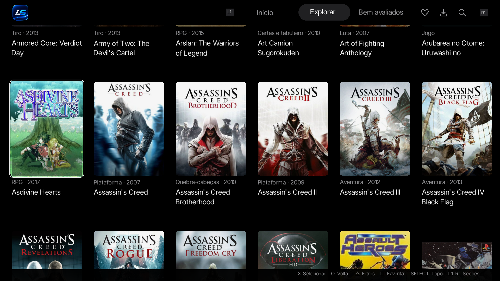

# Lumos Store

[Downloads](https://github.com/pradodev2/lumosstore-ps3/releases) · [Relatar um problema](https://github.com/pradodev2/lumosstore-ps3/issues)

A **Lumos Store** é um aplicativo homebrew para PlayStation 3 com CFW, escrito em C e desenvolvido a partir do [PKGi PS3](https://github.com/bucanero/pkgi-ps3). O projeto reúne navegação por catálogo, informações dos títulos, imagens e gerenciamento de downloads em uma interface própria.

## Interface

Capturas reais da Lumos Store no PS3.


| Explorar o catálogo | Detalhes do jogo |
| --- | --- |
|  |  |

O projeto está em desenvolvimento ativo. Recursos e comportamento podem mudar entre versões.

> [!IMPORTANT]
> A Lumos Store é um projeto independente, sem afiliação com a Sony Interactive Entertainment ou a PlayStation. Utilize apenas conteúdos que você tenha direito de obter e usar.

## Estado atual

O desenvolvimento concentra-se na navegação do catálogo, no carregamento de imagens e na confiabilidade dos downloads e da instalação.

- Catálogo por plataformas, com busca, filtros, favoritos e seleção de versões.
- Detalhes com descrições, gêneros, avaliações, capas e capturas de tela, conforme os dados disponíveis.
- Interface em português e tradução de descrições quando disponível.
- Cache persistente e seleção inicial de artes incluída no pacote.
- Retomada de downloads quando suportada pelo servidor e verificação de integridade quando há hash disponível.
- Integração de instalação pelo webMAN MOD.

A disponibilidade do catálogo, das traduções e das imagens depende dos serviços configurados. Consulte as notas de cada release para conhecer os testes realizados e as limitações daquela versão.

## Compatibilidade testada

A **Lumos Store 1.0.3** foi testada em um PS3 com **CFW 4.93 CEX e Cobra 8.5**.

**Não foi testada no HEN nem em outras versões de firmware/CFW.** A compatibilidade nesses ambientes ainda não foi validada.

## Problemas e relatos

Estabilidade, desempenho e compatibilidade podem variar entre versões e configurações de console.

Ao [relatar um problema](https://github.com/pradodev2/lumosstore-ps3/issues), informe:

- Versão da Lumos Store, modelo do PS3 e versão do CFW.
- Versão do webMAN MOD, caso o problema envolva instalação.
- Passos para reproduzir o erro e o comportamento esperado.
- Captura de tela ou log relevante, quando disponível, sem credenciais ou dados pessoais.

## Instalação e uso

### Requisitos

- PlayStation 3 com CFW e suporte à instalação de homebrew.
- Espaço livre no armazenamento interno para o aplicativo, cache e downloads.
- Acesso à internet para os recursos remotos.
- webMAN MOD para a integração de instalação.

### Instalação

1. Baixe `lumos_store.pkg` na página de [Releases](https://github.com/pradodev2/lumosstore-ps3/releases).
2. Confira o SHA-256 com o arquivo de verificação da mesma release.
3. Transfira o pacote para o PS3 e instale pelo Package Manager.
4. Abra **Lumos Store** na XMB.

O aplicativo utiliza o identificador `LUMOS0001` e o diretório `/dev_hdd0/game/LUMOS0001`. Dados de instalações antigas com outro identificador não são migrados automaticamente.

## Contribuições

Testar o aplicativo e enviar relatos reproduzíveis são formas de contribuir. Verifique os problemas existentes antes de abrir um novo relato.

Para alterações de código, descreva o problema resolvido, mantenha a contribuição focada e informe os testes realizados. Preserve os créditos e os avisos de licença dos componentes utilizados.

## Informações para desenvolvedores

O código-fonte correspondente deve acompanhar cada release em `source.zip`, com scripts de compilação, avisos de autoria e licenças. O pacote instalável e seu SHA-256 também devem estar disponíveis na mesma release.

### Compilação

Utilize Linux ou WSL com PS3DEV/PSL1GHT e as dependências indicadas no código-fonte.

```bash
python3 tools/prepare_worker_key.py
bash tools/build.sh
```

Os artefatos são gerados em `dist/`.

A integração com o serviço remoto utiliza uma credencial de compilação configurada em `LUMOS_API_KEY` ou em `.secrets/lumos_worker_key.txt`. O valor deve conter 64 caracteres hexadecimais minúsculos. Credenciais e configurações privadas não fazem parte do código publicado.

Uma compilação independente pode adaptar os endpoints para utilizar um serviço próprio. O acesso aos serviços oficiais depende de uma credencial aceita por eles. Consulte `docs/WORKER_SECURITY.md` no arquivo de fontes.

### Testes

```bash
bash tools/test.sh
```

A suíte automatizada verifica componentes do aplicativo. A validação de interface, desempenho e fluxos completos também exige testes no PS3.

## Licença

Esta distribuição acompanha a **GNU General Public License versão 2**, disponível em [LICENSE](LICENSE). Componentes de terceiros permanecem sujeitos aos respectivos termos e avisos de autoria.

A Lumos Store contém modificações em relação ao PKGi PS3. Os autores da base original não são responsáveis por essas alterações. O histórico e as notas de versão do código-fonte registram o desenvolvimento da Lumos.

Ao redistribuir o aplicativo, mantenha os avisos aplicáveis e disponibilize o código-fonte correspondente conforme os termos das licenças. O programa é distribuído sem garantia, nos termos da licença.

## Agradecimentos

- [Bucanero / PKGi PS3](https://github.com/bucanero/pkgi-ps3) — base do aplicativo.
- [mmozeiko / PKGi](https://github.com/mmozeiko/pkgi) — projeto de origem do PKGi.
- **Segher Boessenkool** — código ECDSA incluído no projeto.
- [PS3DEV / PSL1GHT](https://github.com/ps3dev/PSL1GHT) e autores das bibliotecas utilizadas — ferramentas e componentes de desenvolvimento.
- **IGDB e respectivos titulares** — metadados e imagens dos títulos. Marcas, capas e capturas pertencem aos seus respectivos titulares; a licença do código não altera os direitos desses materiais.
